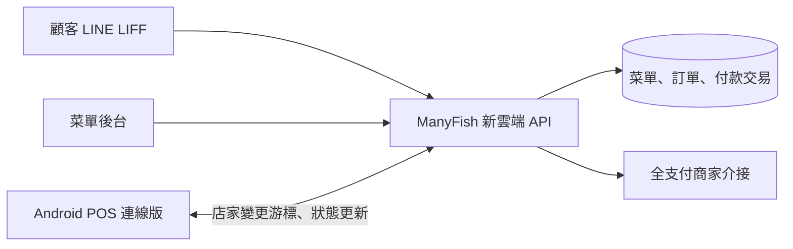

# LINE LIFF 外帶點餐與 ManyFish POS 串接規格

> 2026-10-01 目錄決定：LIFF 顧客網頁與測試位於並列的 ManyFishLINE/web/liff/；共用雲端實作仍位於 ManyFishPOSAndroid/cloud/，Android 收件匣仍位於 ManyFishPOSAndroid/app/。文中的相對程式路徑以各自所屬專案為根目錄。此副本是 LINE 專案規劃入口；Android 原文件保留供整合參考。

狀態：使用者已於 2026-09-26 確認設計；2026-10-02 已完成本機 LIFF 網頁／預約後台、Python 訂單契約與 connected POS 收件匣。真實 LINE／全支付、正式雲端部署尚未完成。

2026-10-01 更新：第一版加入預約取餐；可提前天數由後台設定，不固定一天。訂單送出後立即顯示在 POS，由店員決定開始製作的時間。暫不設定每時段接單容量。

## 現有架構相容約束（2026-10-01 使用者要求）

- Android 延續 Kotlin／Jetpack Compose、ViewModel、repository 及 core:domain／core:data／core:ui 分層；網路、持久化與預約業務驗證不可直接放入 Compose 畫面。
- 沿用現有 connected flavor（com.manyfish.pos.connected），保留 IDoo 登入與菜單更新；不得依舊計畫範例重新建立 flavor 或覆蓋設定入口。LIFF 接 ManyFish 新雲端，不把新通路訂單寫入 IDoo。
- 現有 PosRepository／LocalPosRepository 保持本機交易用途；以獨立 inbox gateway 接收雲端正式訂單，避免把遠端待付款單當作本機草稿或重新結帳。共用模型只抽取真正相同的規則，不能強迫 LIFF 套用 Uber 的人工接單流程。
- 保留 Room schema v2、本機訂單、付款、菜單快照及 JSON 備份相容性。第一版 LIFF 收件匣使用獨立快取；若後續需要改動既有 schema，必須提供保留資料的 migration 與舊資料驗證，不可清空資料重建。
- 金額沿用 scale=2 的 Long／整數最小單位；商品、價格、選項及取餐時間保存成交快照。顧客網頁與伺服器使用一致業務規則，成交金額由伺服器計算。
- demo／verification 維持無網路權限；connected 沿用現有網路入口與設定組裝方式擴充。裝置測試不得卸載日常使用的 demo 或 connected 資料。
- 雲端沿用 cloud/ 的 Python WSGI 與模組邊界；LINE 功能放 cloud/liff_orders，以 adapter 隔離 LINE 身分、付款及儲存。保留現有 Uber webhook 路由、驗簽、防重與 PostgreSQL 收件匣。
- 本機 SQLite 僅作契約驗證；正式訂單沿用已規劃的 PostgreSQL 交易來源與既有 cloud/migrations 編號序列，不建立互相同步的第二套正式訂單來源。雲端平台仍依既有部署規劃，這項功能不自行更換部署商。
- 開發前核對實際檔案，舊計畫中「建立 connected」等過時步驟視為已有能力的相容檢查。驗收包含現有現金結帳、備份／還原、IDoo 菜單更新、離線 APK 權限及 Uber webhook 回歸，另加 LIFF 預約／付款／重連測試。

## 預約取餐（2026-10-01）

### 已確認的營運規則

- 顧客必須選擇取餐日期與時段；後台控制可選範圍。
- `advanceDays` 由後台設定為非負整數：0 只開放今天，1 開放今天與明天，N 開放今天至往後第 N 個日曆日（含）。以店家時區計算，不以送單起算的 N×24 小時計算。
- 後台設定每日取餐時段、時段間隔、最短提前時間、休店日及臨時停用日期。實際數值由店家設定，不在程式寫死。
- 第一版不限制每時段訂單筆數或商品份數；時段沒有額滿狀態，也不做容量預占。
- 所有正式訂單送出後立即顯示在 POS，依預約取餐時間由近到遠排序，再以建立時間、orderId 穩定排序；清楚標示日期、時間及付款狀態。店員自行開始製作，不設到點才顯示或自動開始製作機制。
- 到店付款單送出後即可製作；線上付款單立即可見，但維持 WAITING_PAYMENT，可信付款成功後才可由店員開始製作。預約不改變原有付款與完成限制。
- 後台調整開放天數、時段或休店日只影響新單，既有訂單保留原取餐時間；第一版不提供顧客自助改期。

### 建議的時段與管理契約

以下為預約契約；2026-10-02 已完成本機實作與契約驗證，正式環境仍需另外驗收。

- 店家時區預設 Asia/Taipei。每星期各日可設定多段取餐時窗；單段不得跨午夜，重疊時窗拒絕發布，跨日營業拆成兩天設定。
- 時窗起點與終點都可成為取餐時間，按 `slotIntervalMinutes` 自起點產生候選點，最後一點不得超過終點；相鄰時窗相同取餐點去重。例如 11:00–12:00、間隔 30 分鐘，提供 11:00、11:30、12:00。
- `minimumLeadMinutes` 是從伺服器當下時間起算的最短準備時間；恰好等於邊界可送單。今天過去的時間不提供，休店日與臨時停用日整日排除。
- 設定包含 `scheduleVersion`；管理者以權限及 expectedVersion 發布完整設定，避免兩位管理者互相覆蓋。後台顯示預覽後再儲存；第一版臨時停用以整日為單位。
- `GET /v1/customer/pickup-slots` 回 serverNow、storeTimeZone、scheduleVersion 及可選的 pickupAt（帶 UTC offset 的 ISO 8601），顧客不能用自行拼出的時間繞過規則。
- `POST /v1/customer/orders` 新增必填 pickupAt、scheduleVersion。伺服器以可信店家、伺服器時間與最新設定確認日期範圍、時段、最短提前時間及點餐開關。設定版本變更回 409 PICKUP_SCHEDULE_CHANGED，時段不再可選回 409 PICKUP_SLOT_UNAVAILABLE，前端保留購物車並要求重新選時段。
- 新單驗證與設定發布以交易鎖定或版本比對協調，確保建立交易使用一致的最新設定。訂單保存 pickupAt 的 UTC 時刻、pickupTimeZone 與 pickupScheduleVersion 快照，顧客查單、POS 快照及變更事件都回傳。
- pickupAt 及 scheduleVersion 納入不可變原請求與防重雜湊；相同鍵更換時段回衝突。已提交的原請求重播先查防重鍵，再做新單驗證；即使取餐時間已過、後台改設定或點餐暫停，仍恢復原訂單。
- 預約日截止前建立的線上待付款單，不因跨日或付款延遲消失；仍依原付款狀態機處理。超過取餐時間而未完成的單顯示逾時標示，不自動取消、改期或退款。

### 預約驗收

1. advanceDays=0／1／N、店家午夜跨日與伺服器 UTC 不同日期時，日期上下限一致；非法負值與非整數拒絕設定。
2. 多段時窗、週休日、臨時停用日、時段間隔及最短提前時間邊界皆正確；缺少取餐時間、偽造非時段時間與過期時段不能建立新單。
3. 顧客載入時段後管理者改設定，送單回明確錯誤並保留購物車；設定發布與下單並發時不使用混合版本。
4. 同時多張單選同一時段均可成功；不出現容量額滿限制。重送只留一張單，同鍵換時段回衝突。
5. 成功提交後回覆遺失，再跨日、停用日期或縮短提前天數，仍可用原鍵恢復原單。
6. 今天與明天的訂單都立即在 POS 可見；預約日、付款標示與排序正確。線上未付不能開始製作，到店未付可製作但不可完成取餐。
7. 後台修改不改寫歷史取餐時間；POS 離線重連仍補齊取餐快照，逾時未完成單保留可見。

## 已確認的目標

顧客從 LINE LIFF 選擇外帶自取商品、口味與數量，送出後立即建立一張 ManyFish 正式訂單，Android POS 可看到該單。顧客可選 **全支付線上付款** 或 **到店付款**。線上付款成功後訂單才進製作佇列；到店付款訂單送出後即可製作，付款狀態仍是未付款。店員不需要另按接單；此規則與 Uber Eats 訂單的人工接／拒單流程分開。

本功能接 **ManyFish 新雲端**，沿用其已發布菜單、店家權限、訂單變更游標與 Android 連線版。既有完全離線 demo 不連線、不收 LIFF 單；QuickClickNew／IDoo adapter 不承接 LIFF 顧客訂單。第一版只做外帶自取，不含桌號內用、配送、優惠券、會員點數、LINE 主動推播或自助退款。

## 方案選擇

| 方案 | 取捨 |
| --- | --- |
| **共用 ManyFish 新雲端（採用）** | LIFF 與 POS 讀寫同一筆伺服器訂單、付款與菜單版本；可用單一交易保證防重與跨裝置同步。 |
| LIFF 直接送店內 POS | 依賴店內裝置與區網一直在線，難以提供可靠付款回查與顧客訂單狀態。 |
| LIFF 專用後端再同步 POS | 需要兩套訂單真相來源、價格規則與失敗補送，增加重複單及收款狀態歧異。 |

## 顧客流程

1. 以 LINE LIFF URL 進入 HTTPS 點餐網頁。LINE Login channel 的 LIFF app 開啟 `openid` scope；外部瀏覽器由 LIFF SDK 處理登入。雲端收到 LIFF 原始 ID token 後向 LINE 驗證，核對 channel ID、有效期與使用者，再建立本服務短期會話。伺服器不接受前端送來的 `userId` 或顯示名稱作為身分證據。顧客可自行輸入取餐姓名；第一版不要求電話或 LINE 好友身分。[LINE LIFF 設定](https://developers.line.biz/en/docs/liff/registering-liff-apps)、[LIFF 身分資料](https://developers.line.biz/en/docs/liff/using-user-profile/)
2. LIFF 只展示雲端已發布的本店菜單版本、可售狀態、價格與口味規則；商品卡及口味操作沿用 Android 業務規則。多份口味可少於建議份數，但不可超過群組或單一口味上限；其他必選選項仍須完成。顧客在確認頁看到缺少份數的提醒。
3. 顧客選「全支付線上付款」或「到店付款」，填取餐姓名並按一次送單。前端為本次提交產生穩定 `clientOrderKey`，重試沿用同一鍵。伺服器依已發布菜單版本重新計價與驗證，不接受前端總額作為成交價；於同一交易保存正式訂單、品項與價格快照、來源 `LINE_LIFF`、付款選擇及店家變更事件。顧客收到正式單號及付款／製作狀態；HTTP 回覆遺失後可用原鍵查詢同一單。同一鍵若帶不同品項、金額或付款方式，回衝突錯誤而不改寫原單。
4. 到店付款：訂單立刻進 POS 製作佇列，顯示 `UNPAID_ONSITE`。顧客到店後店員在 POS 選現金，或依既有規劃在外部收款工具確認後記錄「電子支付」；後者明確標為店員確認，不能顯示全支付 API 已驗證。
5. 線上付款：訂單先為 `AWAITING_ONLINE_PAYMENT`，在 POS 可見但不進製作佇列。雲端以同一訂單建立全支付付款嘗試，提供顧客跳轉／付款入口。顧客返回 LIFF 時仍顯示待確認，直到雲端核對全支付的可信交易結果，金額、店家及交易 ID 一致後，才寫入一次 `PAID_ONLINE` 收款紀錄並將訂單送進製作佇列。只有平台確認前次嘗試已終止且不會再扣款，才可對**同一正式訂單**建立新付款嘗試；關閉頁面或回覆遺失時先查詢原嘗試；不可因此產生第二張訂單。若付款結果不確定，標示 `PAYMENT_UNCERTAIN` 並查詢平台，不把跳轉成功當付款成功，也不自動改成到店付款。
6. 顧客可在 LIFF 的「我的訂單」依服務端身分查看本人的單號、付款與製作狀態；POS 更新製作／可取餐後透過雲端反映。第一版顧客需自行重開或刷新頁面查看，不依賴 LINE Messaging API 推播。

## 訂單與付款狀態

正式訂單的存在、付款與製作是三個獨立維度。`LINE_LIFF` 的 `orderId` 為 UUID，另有給顧客取餐的可讀單號；不可用 LINE user ID 或可讀單號作資料庫唯一鍵。

| 維度 | 第一版狀態及規則 |
| --- | --- |
| 訂單 | `PLACED`、`CANCEL_PENDING`、`CANCELED`、`COMPLETED`；送出交易成功即 `PLACED`，不需店員接單。 |
| 付款 | `UNPAID_ONSITE`、`AWAITING_ONLINE_PAYMENT`、`PAYMENT_UNCERTAIN`、`PAID_ONLINE`、`PAID_ONSITE`、`PAYMENT_FAILED`；只有可信支付結果或店員現場確認可轉為已付款。 |
| 製作 | `WAITING_PAYMENT`、`QUEUED`、`PREPARING`、`READY_FOR_PICKUP`、`PICKED_UP`；線上付款成功才由等待付款轉佇列，到店付款送出即進佇列。 |

資料庫以 `(storeId, customerId, clientOrderKey)` 防重建立訂單，以 `(provider, providerTransactionId)` 防重記錄線上付款，以 `(storeId, checkoutKey)` 防重現場收款。建立付款嘗試也使用每張訂單的穩定嘗試鍵，避免 API 回覆遺失後重試建立另一筆扣款。同一訂單最多有一筆有效完成收款；不同付款嘗試保留歷史。POS 不允許將已 `PAID_ONLINE` 的單再次結帳，已 `PAID_ONSITE` 的單也不重啟線上付款。付款方式變更須先確認所有原付款嘗試均已終止且不會再扣款；`PAYMENT_UNCERTAIN` 禁止換方式，交由平台查詢與人工處理。完成或取消後不可一般編輯；變更價格或品項須另立人工處理流程，第一版不在顧客 LIFF 自行修改。

第一版不設定自動取消或過期分鐘數。取消先以短交易記錄 `CANCEL_PENDING`、原 revision 與取消操作鍵，暫停製作推進、新付款嘗試及付款方式切換；網路查詢／終止付款在交易外執行，再以 revision 核對後寫回。查詢當下「未付款」不足以取消：所有嘗試都必須有平台確認已終止且不會再扣款的證據，或從未建立付款嘗試，才可轉 `CANCELED`。不確定時持續待確認。若取消期間確認收款，保留收款證據並標示異常、交人工決定履約或退款，不自動進製作。取消後收到可信扣款也必須保留並顯示異常，不能隱藏或自動重開訂單。全支付實際終止／到期能力待商家文件確認，未具備可驗證的終止能力前不得宣稱已安全取消。

### 付款與完成的不變條件

- `PAID_ONLINE`／`PAID_ONSITE` 不因延遲的 `UNKNOWN`／`FAILED` 降回未付；事件先核對店家、訂單、付款嘗試與平台交易 ID。舊嘗試的失敗只更新其歷史，不覆蓋目前嘗試。
- `UNKNOWN` 或金額不符在未付款單標 `PAYMENT_UNCERTAIN`；已付款單維持已付並另記異常。只有可信且已終止、不會再扣款的失敗才為 `PAYMENT_FAILED` 並允許重試。成功只在正常 `PLACED` 且 `WAITING_PAYMENT` 時推進為 `QUEUED`；重複通知不能重設已開始的製作狀態。
- 資料庫對每張訂單的有效收款建立唯一約束，另對每張訂單限制一個未終止付款嘗試。所有平台事件與實際扣款證據另存；不同交易再次扣款時，保留第二筆證據並建立 `paymentException` 待對帳／退款，不新增第二筆有效收款，也不抹掉扣款事實。本地唯一約束不等於平台不可能重複扣款。
- `READY_FOR_PICKUP → PICKED_UP` 與 `COMPLETED` 必須在同一交易核對有效收款、已付狀態、`PLACED`、無待處理 `paymentException` 及 revision。到店未付可製作到可取餐，但必須先收款才能完成。取消中、已取消與付款異常的單禁止一般製作推進。

### 回覆遺失與跨店隔離

- 新增 `GET /v1/customer/orders/by-client-key/{clientOrderKey}`，由會話顧客與可信店家共同限定。已提交回 200 與原訂單；該範圍無已提交單回 404 `ORDER_NOT_FOUND`；401 重新登入，逾時／5xx 表示未知。404 不保證另一個進行中 POST 不會提交，因此只可沿用原鍵與原請求重送，不能自動換鍵。其他顧客或店家查不到資料。
- 前端在送出前保存同店家／會話擁有者範圍的原鍵及不可變請求至 sessionStorage；不存 token 或 LINE profile，送單必要的取餐姓名只暫存於此請求，確認後刪除。重載先登入核對範圍再查鍵；找到原單即恢復，未知則保留待確認。原 POST 重播先驗證身分與防重鍵／請求雜湊，再做新單菜單與營業驗證；已提交原單不受後續菜單發布或暫停點餐阻擋。
- POS 訂單快取、游標、讀寫與網路回應使用 `InboxScope(environmentId, storeId, pairingGeneration)`。切店、解除配對或重配對時，原子切換範圍並清空畫面；舊範圍資料刪除或不可讀，舊請求遲到不得寫入或重新顯示。既有 demo／Room 資料不受影響。

## 系統邊界與 API 契約

| 邊界 | 核心契約 |
| --- | --- |
| LIFF → 雲端 | `GET /v1/customer/menu` 回已發布菜單與 `menuVersion`；`POST /v1/customer/orders` 帶 `clientOrderKey`、`menuVersion`、品項與選項 ID／數量、付款選擇、取餐姓名；`GET /v1/customer/orders/{id}` 與 `GET /v1/customer/orders/by-client-key/{clientOrderKey}` 均限定本人及本店。 |
| 雲端 → 全支付 | `PaymentProvider` 介面含 `createAttempt`、`verifyReturnOrNotification`、`queryTransaction` 及可選的 `terminateAttempt`；終止能力必須回報是否可驗證，不支援時維持取消待確認。具體 URI、簽章、通知格式、退款能力與憑證由全支付商家介接文件確認後填入，不以 LINE Pay 或全盈+PAY 文件代替。僅伺服器保存商戶密鑰。 |
| 雲端 → Android POS | 店家變更游標包含新單、付款、製作狀態及可讀單號；POS 以 `InboxScope` 加 `orderId` 去重落地。店員操作使用 `expectedRevision` 與 `commandId`；重複或另一裝置衝突回原結果／409，並重新取得最新單。 |
| 管理後台 → 雲端 | 編輯／發布菜單、查看 LIFF 付款待確認與異常單、停用 LIFF 點餐入口；菜單發布沿用完整版本切換。 |

伺服器先在可信店家及顧客範圍解析已存在的防重鍵；只有新單才在驗證店家、可售時間、菜單版本、數量、口味上限與金額後完成建立交易。LINE token 驗證失敗或暫時無法取得驗證結果時不建立訂單。POS 暫時離線時，正式單仍在雲端，顧客看到已建立；雲端記錄 POS 最後同步時間並在管理後台告警。POS 重連後按變更游標取得所有未讀單，不能靠推播到達保證不漏單。店內沒有任何在線 POS 時仍可收單的營運風險必須在試點驗證，後台可暫停 LIFF 點餐。

## 全支付介接前置與資料安全

公開的全支付商家網站確認有合作店家入口，但沒有足以在此確定線上 API 參數、通知驗證、交易查詢與退款流程的公開技術文件；正式介接須向全支付或其指定合作窗口取得商家資格、測試環境、介接文件及密鑰。這些外部材料到位之前，可用假金流 adapter 驗證本服務的狀態機，不宣稱實際全支付付款已完成。[全支付商家網站](https://www.pxpayplus.com.tw/)

LIFF endpoint URL 必須是公開 HTTPS，需申請 LINE Login channel、設定 LIFF ID 與 `openid` scope。官方目前建議新建 LIFF 應用考慮 LINE MINI App；本規格先按使用者指定的 LIFF 設計，入口 URL 與身分 adapter 保持可替換。現有專案沒有 LIFF 網頁、公網域或完整新雲端，這些皆是建置前置。[LINE LIFF 設定](https://developers.line.biz/en/docs/liff/registering-liff-apps)

LINE ID token、服務會話與全支付憑證不得寫入 Android demo、公開網頁原始碼、一般日誌或 URL。雲端記錄交易審計 ID、支付平台交易 ID、金額與狀態；顧客資料最小化，設定保存期限及刪除流程。全支付導向返回頁的參數只能當線索，成功與否由伺服器依正式介接規格核對。

## 驗收與實作順序

1. 固定 LIFF 顧客訂單契約與狀態機，實作假 LINE token verifier／假全支付 adapter 的服務端契約測試。覆蓋重複送單、價格被前端改動、未選滿可送、選項超量拒絕、兩種付款與支付不確定。
2. 建立雲端已發布菜單與 LIFF 外帶網頁，接 LINE Login/LIFF 測試 channel；測試 LINE 內建瀏覽器與外部瀏覽器登入，並以真實 HTTPS endpoint 驗證。
3. 實作 POS 連線版的 LIFF 訂單列表、付款標示、製作狀態及重連補單；維持既有離線 demo 與本機訂單資料。兩台裝置同時更新同一張 LIFF 單時僅一個 revision 成功。
4. 取得全支付商家介接文件後替換假 adapter，測試正常付款、取消、重複通知、通知遺失、查詢逾時、已扣款但回頁失敗、金額不符及不可重複收款。未取得文件與測試商戶之前，線上付款功能不得對顧客開放。
5. 單店試點驗證 POS 離線／重連、菜單發布切換、現場收款、付款待確認、製作完成與日結分欄。線上全支付與現場收款需分別對帳；不將外送平台款項混入本通路。

## 與既有規劃的關係

[雙後端規劃](../../../../ManyFishPOSAndroid/docs/CLOUD_PLAN.md) 的 IDoo 優先順序不變，LIFF 與 Uber Eats 都是 ManyFish 新雲端後續通路。[Uber Eats 架構](../../../../ManyFishPOSAndroid/docs/UBER_EATS_ARCHITECTURE.md) 的平台接／拒單狀態獨立，不能套用到 LIFF。原本「全支付不做串接」指的是店內 POS 的電子支付手動記錄；本規格新增 **LIFF 線上付款** 的全支付介接需求，兩者的證據等級與結帳介面必須區分。
